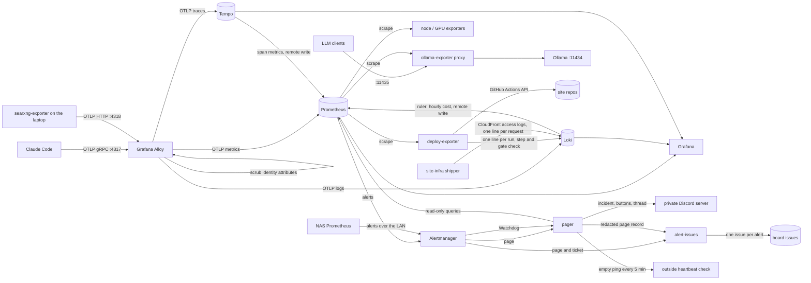

# agent-observability

Metrics, logs and traces for AI coding agents and a self-hosted LLM, on one box, with Prometheus at the centre.

Six sources feed it:

- **Claude Code**, through its built-in OpenTelemetry export: cost, tokens, cache use, tool calls, API errors, permission decisions and interaction traces.
- **Ollama**, through a small metering proxy that turns each inference call into Prometheus metrics named after the OpenTelemetry GenAI conventions: time to first token, decode speed, token counts, model load time, resident models and their VRAM split.

- **Website deploys**, through a small exporter that reads the GitHub Actions runs of three sites (machinebehavior.io, tychat.io, uncovertechtalent.com): every run, its steps, the conformity gate's verdict per check, and what the deploy shipped.
- **AWS spend**, through an exporter that reads the account's cost and usage report from S3 (daily line items with resource ids; Cost Explorer when no report is configured) and AWS Budgets: daily cost by service, usage type and resource for this month and the three before, the month-end forecast, the monthly budget and the month's cost by record type (usage, tax, credits, refunds). The report lands up to three times a day and reading it costs S3 requests only; the exporter checks each billing period's manifest hourly and reads the files again only when the ETag changed, caches every answer and counts its own requests. Cost Explorer (USD 0.01 per request) fills in this month while the report has no file for it yet and, once, the months before the report existed. `aws-cost-exporter/allocation.json` maps every line to a cost center by rule on service, usage type and resource id (virtual tags) and names the cost allocation tag that settles a line first once the account activates one; `fixed-costs.json` holds the costs outside AWS entered by hand; the committed file is the example, the priced copy is `fixed-costs.local.json`, git-ignored and mounted by compose. The dashboards show real spend and stay internal.
- **Website traffic**, from the CloudFront access logs of the static sites: a shipper in [uncovertechtalent-git/site-infra](https://github.com/uncovertechtalent-git/site-infra) (`stats/cloudfront_to_loki.py`, a systemd timer every 5 minutes) writes one Loki line per request. CloudFront records no IP address, and the shipper keeps no User-Agent string and no full referrer URL: only the agent class, the bot name and the referrer host.
- **SearXNG**, the self-hosted search engine the agents search through, by an exporter on the laptop that runs it: whether it answers, searches per minute, latency, results per query, cache hits, each engine's rate limits and blocks, and whether its proxy egress exits from the right IP.

Everything runs from one `docker compose up`. Dashboards, rules and alerts live in the repo as code.



## Run it

```bash
cp .env.example .env        # set GRAFANA_ADMIN_PASSWORD
docker compose up -d --build
```

| Service | Port | Purpose |
|---|---|---|
| Grafana | 3000 | Dashboards in the "Agent Observability" folder |
| Prometheus | 9090 | Metrics, rules, alerts |
| Alloy | 4317 / 4318 / 12345 | OTLP gRPC / HTTP / pipeline UI |
| Loki | 3100 | Claude Code events |
| Tempo | 3200 | Claude Code traces |
| ollama-exporter | 11435 | Metering proxy in front of Ollama |
| deploy-exporter | 9201 | Website deploy runs to Loki, latest state as metrics |
| aws-cost-exporter | 9202 (compose network only) | AWS spend and budget as metrics; reads the host's `~/.aws` read-only |
| blackbox | 9115 (compose network only) | Pings, DNS queries and TCP connects against the LAN, for the `lan-*` scrape jobs |
| Alertmanager | 9093 | Routes alerts by severity, for this Prometheus and the NAS one; basic auth on every endpoint |
| alert-issues | 9095 (compose network only) | Alertmanager's ticket receiver: one GitHub issue per alert |
| pager | 9096 (compose network only) | PagerDuty-style pager on a private Discord server: incidents, rotation, escalation |

Alert delivery needs secrets, each a file with mode 600, owned by the user in `ALERTMANAGER_UID` (default 1000). Without the four delivery secrets the stack runs and the notifications fail, visibly, in the two services' logs; without `web.yml` Alertmanager does not start.

```bash
mkdir -p -m 700 alertmanager/secrets alertmanager/data alert-issues/secrets pager/secrets
umask 077
read -rs v && printf %s "$v" > alertmanager/secrets/discord_webhook_url                # the channel's webhook
read -rs v && printf %s "$v" > pager/secrets/heartbeat_url_agent_observability         # ping URL, check 1
read -rs v && printf %s "$v" > pager/secrets/heartbeat_url_nas                         # ping URL, check 2
read -rs v && printf %s "$v" > alert-issues/secrets/github_token                       # Issues read and write, one repo
read -rs v && printf %s "$v" > pager/secrets/discord_bot_token                          # the pager bot's token
```

Upgrading a stack from before the heartbeat relay: move the ping URLs first, so no heartbeat is lost: `mv alertmanager/secrets/heartbeat_url_* pager/secrets/`, then `docker compose up -d --build`.

The pager's Discord bot needs no privileged intent. Invite it with the scopes `bot` and `applications.commands` and the permissions View Channels, Send Messages, Embed Links, Read Message History, Create Public Threads and Send Messages in Threads (integer 309237730304), and nothing more. On the server, a server admin runs `/pager setup` (the channels for pages, tickets and the alerting path) and `/pager iam` (links their account to a person in `pager/rotation.yml`), so no Discord ID is ever written down.

Every Alertmanager endpoint needs basic auth, because an alert posted to it can end up as a public issue. Each Prometheus gets a user and a random password: the bcrypt hash goes into `alertmanager/secrets/web.yml`, the password into a file only the Prometheus container user (`nobody`, 65534) can read. For this stack's Prometheus:

```bash
pw=$(openssl rand -hex 24)
printf %s "$pw" | python3 -c 'import bcrypt, sys; print("basic_auth_users:\n  agent-observability: " + bcrypt.hashpw(sys.stdin.read().encode(), bcrypt.gensalt()).decode())' > alertmanager/secrets/web.yml
sudo install -d -o 65534 -g 65534 -m 500 prometheus/secrets
printf %s "$pw" | sudo install -o 65534 -g 65534 -m 400 /dev/stdin prometheus/secrets/alertmanager_password
```

A second Prometheus, such as the NAS one, gets its own line in `web.yml` and its own password file next to its config.

Point Claude Code at the stack:

```bash
OBS_HOST=your-host source client/claude-code.env
claude
```

Ship SearXNG's health from the machine that runs it (macOS; Python 3.9+, standard library only):

```bash
mkdir -p ~/.config/searxng-exporter
echo "SEARXNG_METRICS_PASSWORD=<general.open_metrics from settings.yml>" > ~/.config/searxng-exporter/env
sed -e "s#__REPO__#$PWD#; s#__OBS_HOST__#your-host#; s#__HOME__#$HOME#g" \
    -e "s#__PROXY_URL__##; s#__PROXY_EXIT_IP__##" client/searxng-exporter.plist \
    > ~/Library/LaunchAgents/searxng-exporter.plist
launchctl bootstrap gui/$(id -u) ~/Library/LaunchAgents/searxng-exporter.plist
```

Set the proxy URL and its expected exit IP if some engines use a proxy; leave them empty otherwise.

Point LLM clients at `http://your-host:11435` instead of `:11434`. The proxy passes every request through unchanged.

**Transparent mode.** When many clients hardcode Ollama's port, move Ollama instead of the clients: set `OLLAMA_HOST=0.0.0.0:11436` on the Ollama service, then `OLLAMA_PROXY_PORT=11434` and `OLLAMA_UPSTREAM=http://host.docker.internal:11436` in `.env`. Every client is metered and none is edited. The proxy is then in the path of all inference; `restart: unless-stopped` brings it back after a crash, and `OllamaExporterDown` alerts if it stays down. `scripts/load.sh your-host` sends a mixed load so every panel has data.

The `node` and `nvidia-gpu` scrape jobs expect [node_exporter](https://github.com/prometheus/node_exporter) on :9100 and [nvidia_gpu_exporter](https://github.com/utkuozdemir/nvidia_gpu_exporter) on :9835 on the Docker host. Delete the jobs if the host has neither.

## Dashboards

**Local LLM (Ollama).** SLO stats, a time-to-first-token heatmap, p50/p95 by model, decode tokens per second, model load time, token throughput, resident models with their GPU/CPU split, GPU utilisation next to host CPU. The pairing answers the usual question for a small GPU: whether a slow model is slow because it spilled to CPU.

**Claude Code agents.** Spend by model, by source (main loop, subagent, auxiliary) and by skill or agent, with the spend alert's USD 40 threshold as a line on the cost-per-hour chart and the alert's state (below, pending, firing) on a timeline above it; tokens by type; the prompt-cache read share; requests, prompts and tool calls. All of these are sums over Claude Code's events in Loki, one per API call. Then tool calls by outcome and p95 duration, API latency and errors, permission decisions, and the slowest interactions from Tempo.

**Website deploys.** Which site deployed and how long ago, deploy runs per hour by outcome (deployed, blocked by the gate, failed, cancelled), wall time from push to live, where the time goes per workflow step, the gate's result for every check on every run, what the deploy shipped (map snapshot size, links carried forward from unreachable pages) and the decision-probe fold rates the site reports. Deploy markers sit on the duration chart. The dashboard has no template variables and the exporter keeps titles, SHAs and URLs of private repos out of Loki, so it is shared as it is.

**Site traffic.** Page views per hour and site, responses by status code, top pages, countries, referrer hosts, crawlers and scripts by name (the AI crawlers among them), and the paths that answered 404. Page views count HTML pages served with status 200 to browsers; anything whose User-Agent names a crawler, a script or nothing counts as a bot. Scanners that send a browser User-Agent count as browsers. A public cut, **Site traffic (public)**, drops the referrer hosts (they can name an intranet) and the 404 paths (any request picks them) and counts 404s instead. It is provisioned and not shared yet.

**Agent tool calls.** Every tool call of the coding agents and who decided it, from Claude Code's `tool_decision` and `tool_result` events: allowed, denied, asked and hook-blocked counts, denied calls per 15 minutes by source against the alert threshold, calls per hour by decision, counts per tool, and a trail of the denied calls. The `AgentToolDenialsSpike` alert reads `source:claude_code_tool_denials:count15m`, which Loki's ruler records per source over the trailing 15 minutes; the threshold is twice the busiest 15 minutes of the 30 days before it went live. Internal only, with no public cut: with `OTEL_LOG_TOOL_DETAILS=1` the trail shows each call's parameters, shell commands included. Built from the CTO Powersuit's `/ai-ops:tool-audit` spec.

Dashboards are generated by `grafana/build.py` and provisioned read-only. Edit the Python, run it, commit the JSON. Public dashboards in Grafana 12.1 drop annotations that query a data source (the public annotations endpoint returns none of the deploy markers), so anything a visitor must see, such as an alert's state, goes in a panel.

**FinOps: the bill.** One dashboard in the shape of a FinOps tool, fed by the AWS cost exporter, Loki and the fixed-costs file: AWS and the fixed costs as one bill, plus the Claude Code API calls at their list price while the Claude plan has no price, added server side with Grafana expressions; the account's cost by cost center per day and this month against the same complete days of last month; the services that moved most; usage types; the cost per resource (an instance, a bucket, a distribution, a model) from the report's line items, this month and per day, with its own anomaly table; usage, tax, credits and refunds by month; per-service and per-cost-center anomalies against a 28-day median; unit costs over the business metrics the stack already has (AWS per 1,000 searches over 7 days, Claude Code per API call and per 1M output tokens); commitments (none in the account on 2026-10-27, so the panel says so); and a data row with the allocated share, the days compared, the report's delivery age, the source and the forecast method, the resource count, the unpriced items and what the measuring costs. A row after the bill sets the Claude plan against list price: the plan price, the calls this month at list price, a month-end run rate, the projected savings, the multiple, and a chart of the list price added up through the month against the plan. The plan is priced in the git-ignored `fixed-costs.local.json`; once it is, the bill counts the plan price and leaves the list price out, because the plan already pays for the calls, and until then the bill counts the list price. A Grafana expression makes that choice, since PromQL's `or` cannot reach the Loki series, and the row pins itself to the calendar month with a panel relative time of `now/M`. Internal, like AWS spend.

**SearXNG (house search).** Whether the instance and its proxy egress answer, searches per minute by outcome (results, empty, degraded), latency p50/p95 of upstream calls next to the time spent queued for the pacing lock, results per query, cache hits, each engine's latest state on a timeline (ok, empty, rate-limited, blocked, timeout), failed calls by engine and reason, results contributed per engine, SearXNG's own upstream request count per engine, and its error share by error class. A public cut, **SearXNG search engines**, shows only whether the instance answers, searches per hour, the share that return results, results per search, search time and each engine's status, answer rate and median time; nothing about the egress setup.

## Design decisions

**Native OTLP into Prometheus.** Alloy pushes metrics to Prometheus's OTLP receiver (`--web.enable-otlp-receiver`) instead of converting to remote write. Only `service.name`, `service.version` and `host.name` are promoted to labels; the rest of the resource attributes stay on `target_info` and can be joined when needed. An out-of-order window of 30 minutes absorbs late OTLP batches.

**Cost and tokens from per-request events.** Claude Code exports cumulative counters with no per-process attribute: it sets no `service.instance.id`, and `OTEL_METRICS_INCLUDE_SESSION_ID=false` drops the session ID. The desktop app runs several Claude Code processes at once (up to about 12 in the week to 2026-10-09), and all of them write the same Prometheus series. Each interleaved export reads as a counter reset. In that week `resets()` counted 230,328 and `increase()` reported USD 1.97M, while the API calls themselves cost USD 76 in the last 24 hours of it. Prometheus also rejected 235 batches that carried two values for one timestamp.

A per-process label would stop the resets for about 600 extra series a day, some 54,000 at 90-day retention. It would not make the counters exact. Each process's series starts at its first non-zero value, and Prometheus 3.5 does not turn the OTLP start time into a zero sample (tested with `created-timestamp-zero-ingestion`), so `increase()` would lose each process's first export and count a process that exports once as zero.

Claude Code also writes one `api_request` event per API call with its cost and four token counts. Summed in Loki, the events match the local session transcripts within 0.1% for the main model over a week, include side calls the transcripts leave out (prompt suggestions, compaction, web fetch), and are correct back to the first event. The dashboards and the spend alert read the events. Loki's ruler records the hourly cost and writes it to Prometheus for the alert. The counters still arrive in Prometheus; nothing sums them.

**Identity out of storage.** Claude Code attaches the account email, account IDs and organisation ID to every signal. An Alloy attributes processor deletes them before any backend sees them. Prompt and response text stay at Claude Code's default: redacted.

**Cumulative temporality.** Prometheus stores cumulative counters. The client env sets `OTEL_EXPORTER_OTLP_METRICS_TEMPORALITY_PREFERENCE=cumulative`; Alloy's delta-to-cumulative processor is still experimental and stays off.

**A proxy for Ollama.** Ollama has no metrics endpoint, but its final response chunk carries `prompt_eval_count`, `eval_count`, `eval_duration` and `load_duration`. A pass-through proxy reads those without patching the server. Time to first token is recorded for streamed requests only; for a non-streamed response the first byte arrives with the last, and the number would be end-to-end latency under the wrong name.

**SearXNG pushed from a laptop.** The instance runs on a laptop that sleeps and changes address, so its exporter pushes OTLP to Alloy instead of waiting for a scrape. Sleep shows as a gap. The alerts read pushed values, or failure ratios with a minimum number of calls; none reads `up` or `absent()`, which would fire every night. SearXNG's own `/metrics` gives lifetime medians and no suspension state, so per-search data comes from the search wrapper: it writes one JSON line per call (outcome, cache hit, latency, results, the engines that failed and why, no query text) and the exporter turns those lines into counters and histograms. The exporter starts every counter it alerts on at zero, so `increase()` also counts the first failure after a restart.

**Burn-rate alerts with a traffic floor.** Availability (99%) and latency (95% of streamed chat requests see a first token within 4 s) use the multi-window, multi-burn-rate alerts from the Google SRE Workbook. A homelab LLM sees a handful of requests per hour, where one failure is a 100% error ratio, so each availability alert also requires a minimum request rate. `prometheus/tests/alerts_test.yml` checks both cases:

```bash
docker run --rm -v "$PWD/prometheus:/p:ro" -w /p/tests --entrypoint promtool \
  prom/prometheus:v3.5.0 test rules alerts_test.yml
```

**Alerts reach a person.** One Alertmanager serves this stack's Prometheus and the NAS monitoring Prometheus, which sends over the LAN; each server's `external_labels` name it (`prometheus="agent-observability"` or `"nas"`). Severity picks the receiver. A `page` goes to the pager and always to the board as well. A `ticket` goes to `alert-issues`, which opens one GitHub issue per alert fingerprint (labels `kind:finding` and an `area:` label), refreshes it on repeats, closes it with a comment when the alert resolves and reopens it when the alert fires again; an issue a person closed stays closed for the rest of that firing episode. The board repository is public, so an issue carries the alert name, the summary and an allowlist of labels, never the description, the instance or the generator URL. `info` goes nowhere, and so do the three AWS spend rules, which stay a dashboard showcase; `AWSCostExporterStale` is a ticket. A board issue closes when the alert resolves, or after 25 hours with no word from Alertmanager, since an alert that resolves while inhibited or silenced sends no resolved notification; the next firing reopens it. Inhibition keeps one cause to one alert: a down Ollama silences the SLO burns behind it, a down SearXNG the SearXNG symptoms.

**A pager on Discord.** `pager/` is a small PagerDuty-style service. For each page it posts one message in the private server's pages channel, with Acknowledge, Resolve and Escalate buttons, and opens a thread under it for the timeline: fired, notified, re-notified, escalated, acknowledged by whom, resolved. Incidents are keyed by alert fingerprint, so a repeat refreshes the open incident, and Alertmanager's resolve closes it. Tickets get one message each in the tickets channel, linking their board issue. Who is on call and what happens without an acknowledgement come from `pager/rotation.yml`, in the same model as PagerDuty: schedules with layers (a later layer wins), overrides on top (in the file or with `/pager override`), and an escalation policy. The house default: the operator from 08:00 to 22:00 Berlin time, mentioned again every 5 minutes up to 3 times, and the responder agent at 15 minutes. Out of hours nobody is on the first layer, so the responder takes the page at once, and the operator hears at 08:00 if it is still open. The responder agent is deliberately small: it posts the alert's runbook link (`pager/runbooks.yml`) and a diagnosis from read-only Prometheus queries (the alert's expression, minutes firing in 24 hours, `up` of its job, the other alerts firing) into the thread. It changes nothing and never acknowledges. The pager sends the redacted record of each page (names and times, no Discord IDs) to `alert-issues`, which keeps it on the page's public board issue, so a public view needs no endpoint into the house. `/oncall` shows who is on call and the policy. The bot connects out to Discord: no port opens to the internet.

**The redacted page record (stream v1).** The one shape that leaves the pager, built by `core.public_view` and sent to `alert-issues` on every change of a page; the board issue keeps it, and the public on-call snapshot on machinebehavior.io reads it from there. A later consumer, such as a public Discord server, takes the same record as one more sink. Fields are only ever added; removing or renaming one makes v2.

| Field | Type | Meaning |
|---|---|---|
| `alert` | string | alert name |
| `severity` | string | the rule's severity (`page`) |
| `prometheus` | string | the sending Prometheus's external label |
| `fired` | UTC time `YYYY-MM-DDTHH:MM:SSZ` | when the pager opened the incident |
| `acknowledged`, `resolved` | UTC time or null | when it was acknowledged, resolved |
| `acknowledged_by`, `resolved_by` | name or null | a name from `rotation.yml`, or `Alertmanager`, or `Alertmanager (stale)` |
| `responder_ran` | boolean | the responder agent posted its diagnosis |
| `time_to_acknowledge_s`, `time_to_resolve_s` | integer or null | seconds from `fired` |

It never carries a Discord ID, a channel, a label value, the summary or a URL.

**Watching the watcher.** A dead Prometheus and a quiet night look the same, so each Prometheus carries an always-firing `Watchdog`. Alertmanager sends each Watchdog to the pager, which pings that Prometheus's outside heartbeat check every 5 minutes with an empty request, so Alertmanager's JSON (its address, generator URLs, labels) never leaves the house. The check alarms when the pings stop: a dead Prometheus, Alertmanager, pager, box or uplink all stop them. The pager cannot report its own outage, so `PagerDown`, `PagerDisconnected` and `AlertmanagerNotificationsFailing` go past it: to the alerting-path channel by webhook and to the board. The outside heartbeat check alarms into the same channel, from outside. `scripts/check-alerting.sh` checks it all without sending anything: promtool on the config and every rule test, amtool on the config and the routing tree, every alert rule's severity against the route it promises (pass the NAS rule files as arguments to include them), the unit tests of the receiver and the pager, the pager image's imports, and the cost exporter's offline test.

**LAN health.** A power cut restarted every host on a home LAN, left a RAID mirror resyncing for an hour, and raised nothing, because no rule watched a host, a reboot or an array. `prometheus/rules/lan.yml` is the answer, one file for two Prometheus servers: this stack loads it from `rules/`, and a second Prometheus on the LAN (the NAS one) runs a copy unchanged. It alerts on any scrape target down (`ScrapeTargetDown`, except the two jobs that have their own page), a host that stops answering ping (`LANHostDown`), the DNS server in DHCP not answering its own name (`LANDNSDown`, a page) and its spare (a ticket), a server whose upstream does not resolve (`LANUpstreamDNSDown`, a ticket, so an outage of the internet does not page as a DNS fault), a slow resolver, a TCP service that stops accepting connections, a host or UniFi device that restarted in the last 15 minutes, many of them at once (`LANMassReboot`), and software RAID that is resyncing, recovering or degraded (`HostRaidResyncing` as a ticket, `HostRaidDegraded` as a page). The probes run in a blackbox exporter (`blackbox/blackbox.yml`: ping, two DNS queries, a TCP connect). A DNS server is asked for `pi.hole`, which every Pi-hole answers itself (`dns_local`, the server alone), and for `github.com`, which it fetches from its upstream (`dns_upstream`, the server and the internet). The hosts and ports they probe are listed in `prometheus/targets/lan-icmp.local.yml`, `lan-dns.local.yml`, `lan-services.local.yml` and `lan-prometheus.local.yml`: git-ignored, so no address, host name or role enters git; the `*.example.yml` files show the shape (a `name` that shows on the alert and a `role`). Without those files the jobs have no targets and the rules stay quiet. The second view works because each Prometheus probes the hosts that matter most and the other Prometheus itself. Alertmanager mutes this stack's copy of a host or DNS alert while the NAS server's alert for the same `name` fires (`alertmanager.yml`), so a dead host is one ticket, and this stack's copy speaks when the NAS server cannot, for example because its box is down. The same inhibition rule collapses a power cut to one ticket: while `LANMassReboot` fires, the single `HostRebooted` and `UniFiDeviceRebooted` alerts are muted. Both stacks send to the one Alertmanager, so this protects against a dead Prometheus or a dead NAS and not against a dead Alertmanager host: the outside heartbeat checks cover that. A Synology NAS adds `prometheus/rules/synology.yml`: disk crashed or failing (a page), a health warning, new bad sectors or an SSD under 20 percent of its life (tickets), a disk over 60 degrees for 15 minutes, a degraded or crashed volume (a page) and a failed system or fan status. It reads DSM's SNMP agent through `snmp_exporter` with the `synology` module; DSM's agent listens on loopback, so the exporter runs in host network mode on the NAS and the Prometheus there scrapes it with a metric relabel that turns the disk IDs into names. `prometheus/tests/lan_test.yml` and `prometheus/tests/synology_test.yml` check every rule.

**Span metrics.** Tempo's metrics generator writes RED metrics per span name back to Prometheus, so trace-derived latency can be graphed and alerted on next to everything else.

**The cost and usage report as the source.** Cost Explorer answers by service and usage type, never by resource, and bills USD 0.01 a request. The cost and usage report (the legacy CUR; Data Exports is its successor with the same content under other column names) is free, lands in S3 up to three times a day and carries every line item with its resource id. The exporter reads it when `AWS_CUR_BUCKET` is set in `.env` (`AWS_CUR_PREFIX` and `AWS_CUR_REPORT` default to `finops`): one folder per billing period under `<prefix>/<report>/`, a manifest whose `reportKeys` name the data files of the latest delivery, CSV gzip. The report definition that fits: time unit DAILY, format text/csv with GZIP, the RESOURCES schema element, versioning OVERWRITE_REPORT (one file set per month, replaced at each delivery) and refresh of closed reports on, into a bucket whose policy lets `billingreports.amazonaws.com` put objects; `aws cur put-report-definition` creates it and the first delivery takes up to 24 hours. Report lines get the service names Cost Explorer uses (tax is the service `Tax`; EC2 splits into instance hours and `EC2 - Other`), so the allocation rules and both dashboards read the same names from either source, and resource ids lose their ARN prefix. The days a delivery may still change (its own day, and the day before when it came before noon UTC) count as estimated and stay out of the complete-day series; the month-end forecast is the run rate of the complete days. A new report has no past: the exporter asks Cost Explorer once for the months before it and keeps that history until the report's own months age it out, and asks for this month every 12 hours while the report has no file for it (the first day of a report, the first hours of a month). The report's line item types Fee and RIFee read as Cost Explorer's record types Upfront and Recurring, so the record-type panel keeps one vocabulary across both sources. `AWSCostReportStale` opens a ticket when no delivery has landed for 36 hours while the exporter still polls S3 (a deleted definition, a broken bucket policy). Rolling back to the Cost Explorer source is unsetting the bucket; the report part of the cache is ignored. The AWS profile the exporter runs with needs no more than this (the bucket and prefix are the report definition's; `budgets:ViewBudget` is what DescribeBudgets checks):

```json
{"Version": "2012-10-17", "Statement": [
  {"Effect": "Allow", "Action": "s3:ListBucket", "Resource": "arn:aws:s3:::<bucket>",
   "Condition": {"StringLike": {"s3:prefix": "finops/finops/*"}}},
  {"Effect": "Allow", "Action": "s3:GetObject", "Resource": "arn:aws:s3:::<bucket>/finops/finops/*"},
  {"Effect": "Allow", "Action": ["ce:GetCostAndUsage", "ce:GetCostForecast", "budgets:ViewBudget"], "Resource": "*"}
]}
```

**Deploys read from the outside.** The exporter polls the GitHub Actions API and the sites' public JSON instead of pushing from inside the workflows. The site repos stay unchanged, no ingest endpoint is exposed, and a run that dies before any step can report is still recorded, as is a run the gate blocks. History goes to Loki at the time each run finished, so a fresh exporter backfills the last week (Loki's limit for old samples) and Grafana draws it at once; replayed lines are exact duplicates and Loki drops them. Job logs expire on GitHub after a while; older runs keep their timings but lose the per-check verdict. Tokens are fine-grained and read-only: the exporter needs Actions (read) and Metadata (read), nothing more. One token covers one owner, so the exporter takes `GITHUB_TOKEN` for the user's repos and `GITHUB_TOKEN_<OWNER>` for another owner's, for example `GITHUB_TOKEN_UNCOVERTECHTALENT_GIT`; each new owner also needs its own line in `docker-compose.yml`, and `GITHUB_TOKEN_OWNER` names the owner `GITHUB_TOKEN` covers. At startup the exporter logs which site lacks a token.

## Layout

```
alloy/config.alloy               OTLP receive, scrub, batch, fan out
prometheus/prometheus.yml        scrape jobs, OTLP settings, external label, Alertmanager target
prometheus/rules/                recording rules, SLO burn-rate and symptom alerts, Watchdog
alertmanager/alertmanager.yml    routes by severity, inhibition, waking hours, receivers
alert-issues/                    ticket receiver: one GitHub issue per alert
pager/                           Discord pager: core.py (schedule, escalation, incidents), bot.py, diagnose.py
pager/rotation.yml               who is on call, overrides, the escalation policy
prometheus/rules/lan.yml         LAN health: scrape targets, hosts, DNS, reboots, RAID (also run on the NAS Prometheus)
prometheus/rules/synology.yml       Synology NAS disks, volume and system status from SNMP (NAS Prometheus only)
prometheus/targets/              file_sd lists for the lan-* probe jobs: *.example.yml committed, *.local.yml git-ignored
blackbox/blackbox.yml            blackbox modules: icmp, dns_a, tcp_connect
prometheus/tests/                promtool unit tests
loki/ tempo/                     single-binary configs, 90-day and 14-day retention
loki/rules/                      Loki ruler: Claude Code hourly cost for the spend alert
grafana/build.py                 dashboards as code
grafana/dashboards/              generated JSON, provisioned read-only
ollama-exporter/                 the metering proxy
deploy-exporter/                 website deploy runs from GitHub Actions
aws-cost-exporter/               AWS spend from the cost and usage report in S3 (or Cost Explorer) and AWS Budgets;
                                 allocation.json (cost centers by rule and tag), fixed-costs.json (costs outside
                                 AWS, by hand), test_exporter.py (offline test of both modes)
client/claude-code.env           Claude Code telemetry settings
client/searxng_exporter.py       SearXNG health, pushed as OTLP from the machine that runs it
client/searxng-exporter.plist    launchd agent for it (macOS)
scripts/load.sh                  demo load
scripts/check-alerting.sh        promtool, amtool and route checks; receiver unit tests
```

## License

MIT
